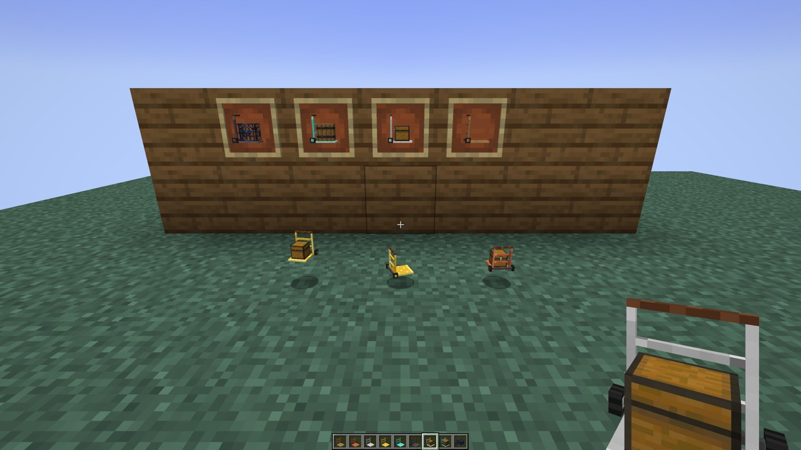
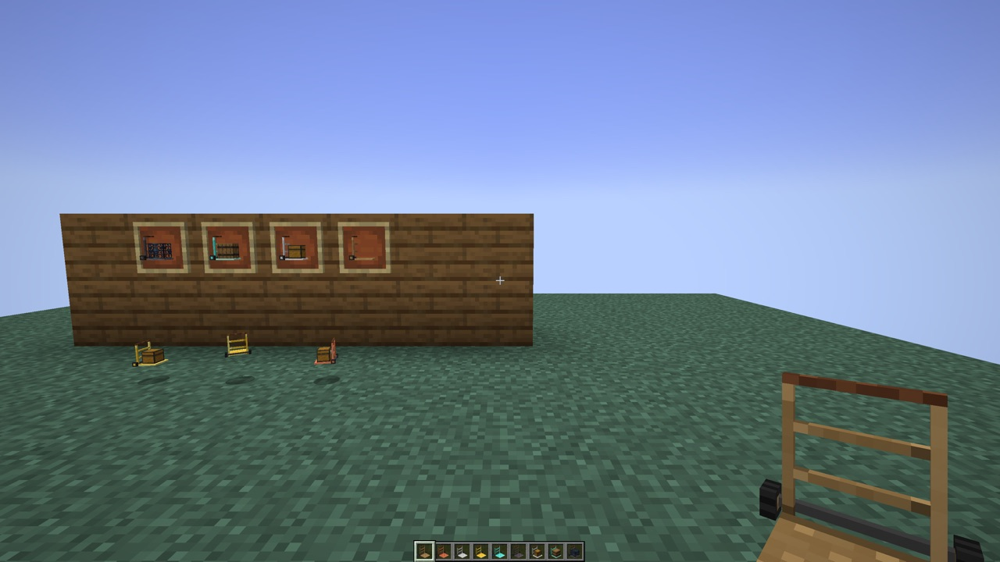
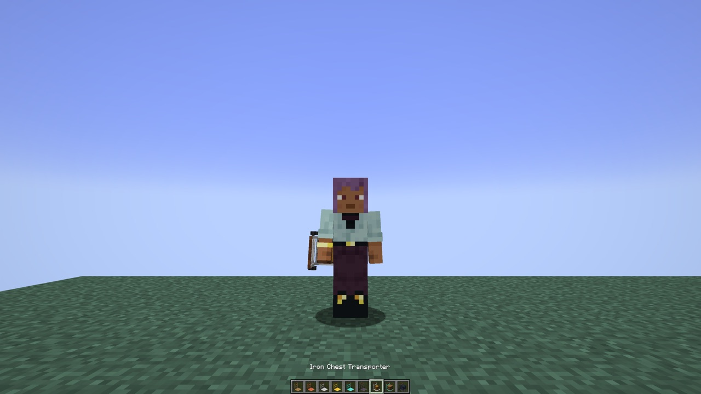
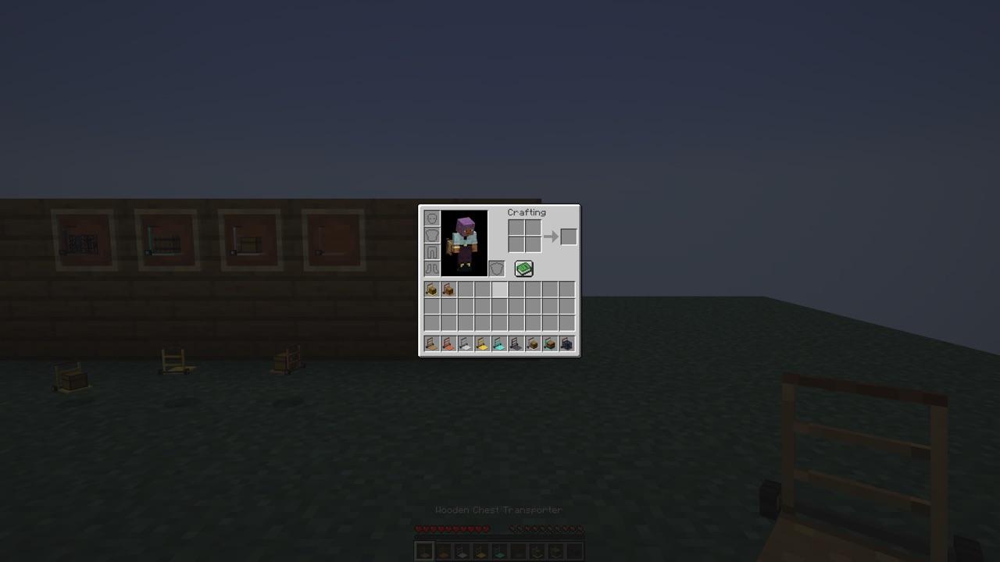

# Chest Transporter — NeoForge 1.21.1

**A hand truck that picks up chests, barrels and spawners with everything inside and puts them down somewhere else.**

<b>🇬🇧 English — click to open</b>

## Download

| Version | Minecraft | Loader | Java |
| --- | --- | --- | --- |
| 1.0.0+1.21.1 | 1.21.1 | NeoForge 21.1.197 or newer | 21 |

Releases: [GitHub releases](../../releases). Install on the server **and** on every client.

## How it works

- **Right-click** a chest, trapped chest, barrel or monster spawner with an empty truck: the block is loaded with
  everything inside (items, custom name, unopened loot, the spawner's mob). Nothing drops.
- **Right-click** any block with a loaded truck: the load is put down next to it, facing you, like placing a block.
  A chest put down next to another chest joins it into a double chest. Half of a double chest is taken on its own.
- **Minecarts:** right-click a minecart with chest to take its chest (a plain minecart stays), right-click a plain
  minecart with a carried chest to put it back.
- **Heavy:** while a loaded truck is anywhere in your inventory you walk and mine slower, cannot jump up a full block
  and get hungry faster (not in creative mode).
- **Safe:** protected areas (spawn protection, claim mods that cancel block breaking), locked containers and contents
  over the size limit are refused with a message.
- Each put down costs one point of durability. Trucks are repaired in an anvil with their material.

## Trucks

| Truck | Moves | Recipe |
| --- | --- | --- |
| Wooden | 1 | `S S` / `S S` / `PPP` — sticks and planks |
| Copper | 4 | sticks and copper ingots |
| Iron | 9 | sticks and iron ingots |
| Golden | 19 | sticks and gold ingots |
| Diamond | 79 | sticks and diamonds |
| Netherite | 159 | smithing table: netherite upgrade + diamond truck + netherite ingot; does not burn |

## Config

`config/chest_transporter-server.toml` (synced to the clients):
- `pickup.spawners` — spawners can be carried at all (default `true`);
- `pickup.spawnerTiers` — trucks that take spawners (default: all);
- `pickup.maxDataKiB` — largest load in KiB (default 1024), so the item can always be sent to clients;
- `carrying.slowness`, `carrying.miningFatigue`, `carrying.noJump`, `carrying.hunger` — the effects of a loaded truck.

Block tags for packs: `chest_transporter:transportable` (chests, trapped chests, barrels — add modded containers here),
`chest_transporter:spawners`, `chest_transporter:not_transportable`.

## Languages

English, Russian, Ukrainian, German, Spanish, Brazilian Portuguese.

## License and credits

[LGPL-3.0-only](LICENSE). The idea of carrying chests with their contents comes from
[Chest Transporter](https://www.curseforge.com/minecraft/mc-mods/chest-transporter) by **cubex2** (Minecraft 1.12.2).
This mod is written from scratch for NeoForge 1.21.1: its code, model and textures are new. Made by Vladeezyy; how it
was built and tested: [DEVLOG.md](DEVLOG.md).

<b>🇷🇺 Русский — нажмите, чтобы открыть</b>

## Скачать

| Версия | Minecraft | Загрузчик | Java |
| --- | --- | --- | --- |
| 1.0.0+1.21.1 | 1.21.1 | NeoForge 21.1.197 или новее | 21 |

Релизы: [GitHub releases](../../releases). Ставить на сервер **и** на каждый клиент.

## Как работает

- **ПКМ** пустой тележкой по сундуку, сундуку-ловушке, бочке или рассаднику монстров: блок грузится со всем
  содержимым (предметы, своё имя, неоткрытая добыча, моб рассадника). Ничего не выпадает.
- **ПКМ** гружёной тележкой по любому блоку: груз ставится рядом, лицом к вам, как обычный блок. Сундук, поставленный
  рядом с другим, соединяется в двойной. Половину двойного сундука можно увезти отдельно.
- **Вагонетки:** ПКМ по вагонетке с сундуком — сундук на тележку, остаётся обычная вагонетка; ПКМ сундуком на
  тележке по обычной вагонетке — вернуть его.
- **Тяжело:** пока гружёная тележка где-то в инвентаре, вы медленнее ходите и копаете, не запрыгиваете на целый блок и
  быстрее голодаете (кроме творческого режима).
- **Безопасно:** защищённые места (защита спавна, приваты, отменяющие ломание блоков), запертые контейнеры и слишком
  большое содержимое — отказ с сообщением.
- Каждая установка тратит единицу прочности. Чинится на наковальне своим материалом.

## Тележки

| Тележка | Перевозок | Рецепт |
| --- | --- | --- |
| Деревянная | 1 | `S S` / `S S` / `PPP` — палки и доски |
| Медная | 4 | палки и медные слитки |
| Железная | 9 | палки и железные слитки |
| Золотая | 19 | палки и золотые слитки |
| Алмазная | 79 | палки и алмазы |
| Незеритовая | 159 | кузнечный стол: шаблон незеритового улучшения + алмазная тележка + незеритовый слиток; не горит |

## Конфиг

`config/chest_transporter-server.toml` (передаётся клиентам):
- `pickup.spawners` — можно ли вообще возить рассадники (по умолчанию `true`);
- `pickup.spawnerTiers` — какие тележки берут рассадники (по умолчанию все);
- `pickup.maxDataKiB` — наибольший груз в КиБ (по умолчанию 1024), чтобы предмет всегда доходил до клиентов;
- `carrying.slowness`, `carrying.miningFatigue`, `carrying.noJump`, `carrying.hunger` — эффекты гружёной тележки.

Теги блоков для сборок: `chest_transporter:transportable` (сундуки, сундуки-ловушки, бочки — сюда добавлять модовые
контейнеры), `chest_transporter:spawners`, `chest_transporter:not_transportable`.

## Языки

Английский, русский, украинский, немецкий, испанский, бразильский португальский.

## Лицензия и авторы

[LGPL-3.0-only](LICENSE). Идея возить сундуки с содержимым взята из
[Chest Transporter](https://www.curseforge.com/minecraft/mc-mods/chest-transporter) от **cubex2** (Minecraft 1.12.2).
Этот мод написан с нуля для NeoForge 1.21.1: код, модель и текстуры новые. Автор — Vladeezyy; как делали и проверяли:
[DEVLOG.md](DEVLOG.md).

